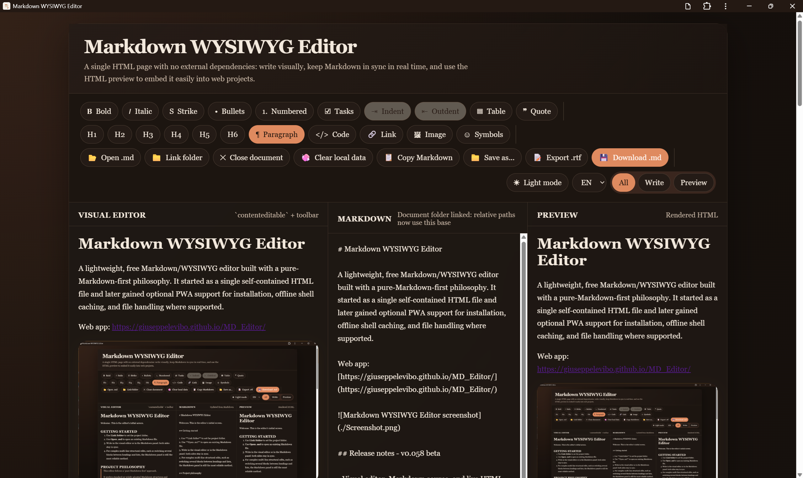

# Markdown WYSIWYG Editor

A lightweight, free Markdown/WYSIWYG editor built with a pure-Markdown-first philosophy. It started as a single self-contained HTML file and later gained optional PWA support for installation, offline shell caching, and file handling where supported.

Web app: [https://giuseppelevibo.github.io/MD_Editor/](https://giuseppelevibo.github.io/MD_Editor/)

## Release notes - v0.66.1

- Fixed: the welcome document, with the updated shortcut table, appears again on every new launch; since v0.65.0 it appeared only on the very first launch
- `Close document` still leaves a blank sheet, and a refresh keeps it blank

## Release notes - v0.66.0

- Keyboard shortcuts follow Word and Google Docs: `Ctrl/Cmd + O` opens a file, `Ctrl/Cmd + U` underlines (saved as `<u>`), `Ctrl/Cmd + K` inserts a link, `Ctrl/Cmd + Alt + 0-8` set paragraph styles, `Ctrl/Cmd + Shift + 7/8/9` create lists, `Alt + Shift + 5` strikes through
- The same shortcuts work in the Markdown panel; `Ctrl/Cmd + /` shows them all
- Shortcuts are matched by physical key, so they work with any keyboard layout
- New Underline button; underline, superscript, and subscript are kept in RTF export
- The welcome document lists the current shortcuts and explains how underline is stored

User-facing release notes are in [RELEASE_NOTES.md](./RELEASE_NOTES.md).

## Release notes - v0.65.0

User-facing release notes in Italian and English are in [RELEASE_NOTES.md](./RELEASE_NOTES.md).

- Clearer file commands: `Save` (Ctrl/Cmd + S) writes to the open file, or asks once where to save and then keeps the document connected to that file; `Save as...` (Ctrl/Cmd + Shift + S) switches the document to the new file
- Saving checks whether another program changed the file since it was opened and asks before overwriting it
- Status messages say what happened ("Saved to disk: name.md", "Downloaded: name.md", permission or write errors) instead of always reporting a download
- `Close document` always leaves a blank sheet; the welcome document appears only on the first launch
- A page refresh keeps the document name and its saved/modified state
- Dropped files keep their file handle in Chromium, so `Save` and `Reload file` work as for files opened with the picker
- Fixed: a double unsaved-changes prompt in browsers without the File System Access API, a second folder picker after cancelling `Link folder`, and a failed open disconnecting the current document from its file
- Optional device memory (off by default): remember recent files, linked folders, and the unsaved draft across app restarts; see [Privacy and shared computers](#privacy-and-shared-computers)

## Release notes - v0.64.0

- Markdown is now parsed with the vendored [markdown-it](https://github.com/markdown-it/markdown-it) engine (CommonMark + GitHub tables and strikethrough), so files render like they do on GitHub or in VS Code: multi-line paragraphs, `_emphasis_` / `__strong__`, backslash escapes, setext headings, `~~~` fences, indented code, code blocks inside list items, lists nested with 4 spaces or tabs, link titles, autolinks, URLs with `&` or parentheses
- Footnotes (`[^1]`), GitHub alerts (`> [!NOTE]`), YAML front matter, and HTML entities
- Raw HTML in Markdown documents (`
`, ` `, ``, `<kbd>`, ``, ...) is rendered after DOMPurify sanitization; unsafe tags such as `<script>` stay visible as text, and non-Markdown files keep showing their markup as text
- Visual edits no longer rewrite the whole document: untouched blocks keep their exact Markdown source, and toggling a task checkbox only flips its `[ ]` / `[x]` marker
- Nested lists under numbered items are saved with CommonMark indentation (3 spaces under `1.`); older files with 2-space nesting still render nested
- Mermaid diagrams keep their arrowheads in preview-only mode, and invalid diagrams no longer leave error graphics at the bottom of the page
- UTF-16 (with BOM) and legacy Windows-1252 files open correctly; files with Windows line endings no longer look modified right after opening and are saved back with CRLF
- Relative image paths with `%20`-style escapes resolve, and Markdown files opened from a subfolder of the linked folder resolve their own relative images
- In-document links written for GitHub-style anchors (accents kept, `---` for ` - `) scroll to the matching heading

## Release notes - v0.63.5

- Visual editor, Markdown source, and live HTML preview kept in sync for everyday writing
- Desktop view modes now include paired writing, visual-only, Markdown-only, preview-only, and full workspace layouts
- Full, paired, and single-pane writing modes can transfer the caret between Visual editor and Markdown at the matching document position
- Open, edit, save, and download `.md` files
- Open readable text files such as `.txt`, `.json`, `.yaml`, `.csv`, `.log`, and source files
- Show document name, clean/modified state, length, and caret position in the PWA window title
- Validated drag-and-drop opening with the same safety checks as `Open .md`
- Project-folder linking for relative images and local Markdown links
- In-document index links scroll to their matching heading instead of opening a blank document
- Inline and display LaTeX math rendering through vendored KaTeX assets, with both `$...$` / `$$...$$` and `\(...\)` / `\[...\]` delimiters
- Mermaid graph rendering for fenced `mermaid` blocks in the visual editor and live preview
- Syntax highlighting for fenced code blocks in the visual editor, live preview, and browser print/PDF output
- Editable `RTF` export for Word/LibreOffice workflows
- Installable PWA shell with desktop-style usage on supported Chromium browsers
- Italian/English UI, dark mode, symbol picker, mobile mode, and privacy-oriented local reset
- Close-warning protection when the current document has unsaved changes

This is a stabilization beta focused on simplicity, portability, and common Markdown structures. For complex structural edits across multiple selected lines, the Markdown panel is still the most reliable editing surface.

## Features

- Visual editor, Markdown source, and live HTML preview
- Static app with vendored runtime assets for offline Markdown parsing, HTML sanitization, math, Mermaid graphs, and syntax highlighting
- CommonMark/GitHub-flavored Markdown rendering through markdown-it, with footnotes, alerts, front matter, and sanitized raw HTML
- Source-preserving visual editing: only the blocks edited in the visual editor are re-serialized
- Visual nested-list editing with indent/outdent controls
- Render LaTeX math written as `$inline$`, `$$display$$`, `\(inline\)`, or `\[display\]`
- Render Mermaid graphs written in fenced `mermaid` code blocks
- Highlight fenced code blocks with explicit languages such as `js`, `ts`, `html`, `css`, `json`, `python`, `bash`, and `markdown`
- Open and edit `.md` files
- Link a project folder to resolve relative images and local assets
- Insert uploaded images directly into Markdown
- Special symbols and emoji picker
- Italian and English interface
- Installable PWA shell on supported browsers

## Recommended workflow for Markdown files with local images

1. Click `Link folder`.
2. Select the project folder or the folder that contains the Markdown file.
3. Click `Open .md`.
4. Open the Markdown document you want to edit.

If the browser supports it, the file picker will try to reopen from the linked folder.

## RTF export notes

The editor can export the current rendered document as an editable `.rtf` file for Word-compatible word processors.

- Text structure is preserved: headings, paragraphs, lists, tables, links, blockquotes, and code blocks.
- LaTeX math is rendered in the browser view and therefore in browser print/PDF output. `RTF` export preserves the original LaTeX source as editable monospace text, not as native Word equations.
- Syntax highlighting is preserved in the browser-rendered view and therefore in browser print/PDF output. `RTF` export intentionally keeps code blocks as plain monospace text without token colors.
- Safe bitmap images are embedded when available: `PNG`, `JPEG`, and `GIF`.
- `SVG` images are currently not embedded in the `RTF` output.
- This is intentional for now: bitmap embedding is stable, while `SVG` would require an extra rendering/conversion step that goes beyond the current single-file safety model.

So if an `SVG` image is not embedded in the exported `RTF`, that is currently a supported limitation rather than a broken export.

## Notes about `Documents`

Some browsers treat special system folders such as `Documents` differently from normal folders.

- Opening and saving files in `Documents` may work.
- Linking `Documents` itself as a project folder may be blocked by the browser.
- Subfolders inside `Documents` usually work correctly and are the recommended choice.

This behavior comes from browser security rules, not from the editor itself.

## Privacy and shared computers

The editor is often used on shared computers (schools, libraries, study rooms), so it keeps as little as possible by default:

- The unsaved draft and the name of the open document survive a page refresh in the same tab only (`sessionStorage`); closing the tab or the app discards them.
- File and folder access granted to the editor is not remembered: after closing the app you open the file again.

**Device memory** (the 🔒/🔓 `Remember` button) is off by default. Turn it on only on a computer that is yours: it asks for confirmation and warns about shared computers. While it is on, the editor stores in this browser (IndexedDB):

- up to 8 recent files with their linked folders, available from the 🕘 `Recent` button;
- the unsaved draft, restored when the app starts again, with a button to reconnect it to its file.

Entries older than 30 days are deleted automatically. Turning the memory off deletes everything it stored.

`Clear local data` removes:

- drafts, recent files, remembered folders, and the device memory setting;
- saved interface preferences such as language and view mode;
- local editor state for the current workstation/browser profile.

It does not delete the original Markdown files on disk, inside the project folder, or on a USB drive. Files you downloaded and the browser history are managed by the browser, not by the editor; on a shared computer, a private/guest browser window avoids leaving them behind.

## PWA support

The repository includes:

- `manifest.json`
- `sw.js`
- SVG icons for the installed app shell
- vendored KaTeX CSS, JS, and fonts for offline LaTeX math rendering
- vendored PrismJS CSS and language components for offline syntax highlighting
- vendored markdown-it (with the footnote plugin) and DOMPurify for offline Markdown parsing and HTML sanitization

File Handling API support depends on the browser and operating system. Chromium-based browsers generally offer the best support, especially after the app is installed.

## Current note about complex visual formatting

The visual editor is reliable for normal writing, inline formatting, lists, links, images, and common block changes.

For complex structural changes across multiple selected lines, especially when switching between headings and lists, the Markdown panel is currently the most reliable editing surface.

## Keyboard shortcuts

Shortcuts follow Word and Google Docs. They work in the visual editor and in the Markdown panel, and are matched by the physical key, so they also work with non-Latin keyboard layouts. On macOS use Cmd instead of Ctrl and Option instead of Alt. `Ctrl/Cmd + /` shows the full list inside the app.

| Command | Shortcut |
| --- | --- |
| Open file | `Ctrl/Cmd + O` |
| Save / Save as | `Ctrl/Cmd + S` / `Ctrl/Cmd + Shift + S` |
| Print / PDF | `Ctrl/Cmd + P` |
| Reload file from disk | `Ctrl/Cmd + Shift + R` |
| Undo / Redo | `Ctrl/Cmd + Z` / `Ctrl/Cmd + Y` or `Ctrl/Cmd + Shift + Z` |
| Find and replace | `Ctrl/Cmd + F` or `Ctrl/Cmd + H` |
| Bold / Italic / Underline | `Ctrl/Cmd + B` / `Ctrl/Cmd + I` / `Ctrl/Cmd + U` |
| Strikethrough | `Alt/Option + Shift + 5` or `Ctrl/Cmd + Shift + X` |
| Link | `Ctrl/Cmd + K` |
| Normal text | `Ctrl/Cmd + Alt/Option + 0` |
| Heading 1-6 | `Ctrl/Cmd + Alt/Option + 1` ... `6` |
| Quote / Code block | `Ctrl/Cmd + Alt/Option + 7` / `8` |
| Bulleted / Numbered / Task list | `Ctrl/Cmd + Shift + 8` / `7` / `9` |
| Indent / Outdent list item | `Tab` / `Shift + Tab` |
| Keyboard shortcut list | `Ctrl/Cmd + /` |

**Underline:** Markdown has no underline, so `Ctrl/Cmd + U` saves it as `<u>text</u>`. The editor shows it correctly; other programs or sites (for example GitHub) may show it as plain text.

`Ctrl/Cmd + N` (new document) is reserved by browsers; use `Close document` to start a blank sheet. On keyboard layouts where `AltGr + digit` types a character (for example `{` on German keyboards), the character is typed instead of the Ctrl+Alt shortcut.

## Development

This project is intentionally simple and easy to inspect. Most of the application still lives in `index.html`, with a small set of extra files required by the PWA layer.
